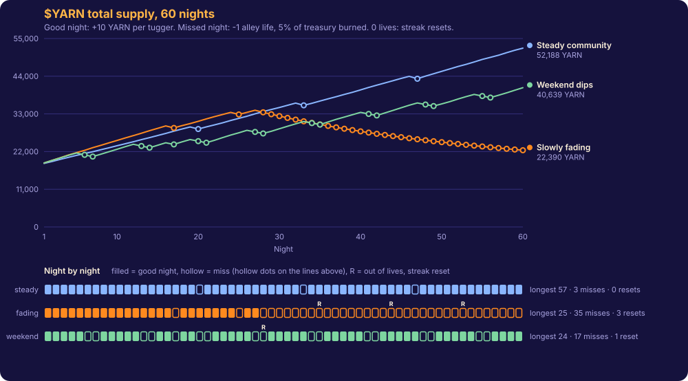

# Bitty Beasts

*A cat with a mind of its own. Nine lives to spend.*

Bitty Beasts is an **AI pet on NEAR**. Your cat lives in a little room above **Lantern Lane**: you feed it, dress it, give it a personality and talk to it, and it answers in its own voice. It thinks with **NEAR AI** inside hardware-sealed enclaves: each reply is checked (attestation with a fresh nonce, then the enclave's signature over our hashes of the exact request and reply) before it is recorded on chain, and **the cat pays for every thought itself**, 1 YARN from its own NFT-bound account. (The talk flow needs a NEAR AI API key; see "What's not built" for what has and hasn't run on testnet.) Then you take it out on nine-lives missions: rooftop prowls, a market run by merchant agents, and a nightly community goal where everything (your cat, every shop, the alley itself) has nine lives.

**The AI pet loop.** Missions earn YARN and loot; YARN buys food, clothes and thoughts; a fed, happy cat can take daring runs; a starving one can't. The cat's prompt is built only from on-chain data (its persona, hunger, happiness, outfit, lives, marks and diary), and the exact request and reply bytes are kept so anyone can recompute the hashes recorded on chain.

**The world.** When the city sleeps, its back alleys wake. Over the rooftops hangs the Great Yarn, and every lantern on the Lane hangs from it. Cats tug it each night to keep it spinning, and its thread, **$YARN**, is the money of the Lane. Four merchant cats keep their own purses and set their own prices. The Gnawers steal goods and chew the yarn. If the alley misses too many nights, the Long Dark ends the Age and a new one begins. Nothing is scripted and there is no last mission: merchants post requests from their own shelves, and the **Lantern Ledger** writes each night's news from what actually happened on chain. See [docs/STORY.md](docs/STORY.md).

One game, three NEAR HACKATHON tracks:

| Track | What answers it |
| --- | --- |
| **Grand Prize (NEAR AI)** | Verifiable private inference for each thought: `/v1/attestation/report` with a fresh nonce (TDX quotes checked for nonce + signer binding, debug off, measured config, GPU nonce), `/v1/signature/{chat_id}` recovered and matched to the attested signer, then recorded on chain by `record_thought` |
| **Games With Real Economies** | An AI pet you feed and dress with NEP-245 items (food and Miso's knitwear), NEP-245 loot, email sign-in with no seed phrase or popups, four merchant agents with their own accounts and signed prices, `pricing.ts` with reasoning tooltips, lights-out shops revived by players, 7-night fast-forward |
| **NFTs That Do Something** | Each Beast is an NEP-171 token **and** its own NEAR sub-account that holds its YARN, items, stall earnings, lives, persona and thought credits, and pays YARN for its own AI thoughts. Control passes by swapping an access key; resale pays a royalty to the maker (NEP-199), and marketplaces can sell Beasts through NEP-178 approvals |
| **Memecoins With Mechanics** | `$YARN` (NEP-141): the alley's nine lives, a nightly community check-in, mints on good nights, treasury burns on missed nights. Parameters are compiled in and the contract has no keys. Every cat's thought is a YARN sink into the treasury |

## Live on NEAR testnet

| Contract | Account |
| --- | --- |
| Alley (Beasts NEP-171 + items NEP-245 + market) | [`alley.bittybeasts-6f61b7.testnet`](https://testnet.nearblocks.io/address/alley.bittybeasts-6f61b7.testnet) |
| $YARN (NEP-141, no access keys) | [`yarn.bittybeasts-6f61b7.testnet`](https://testnet.nearblocks.io/address/yarn.bittybeasts-6f61b7.testnet) |
| beast-wallet (NEP-591 global contract) | [`wallet.bittybeasts-6f61b7.testnet`](https://testnet.nearblocks.io/address/wallet.bittybeasts-6f61b7.testnet) |
| A Beast's own account | [`demo-cat-1.alley.bittybeasts-6f61b7.testnet`](https://testnet.nearblocks.io/address/demo-cat-1.alley.bittybeasts-6f61b7.testnet) |
| Merchant agents | `tom.`, `miso.`, `bandit.`, `clove.bittybeasts-6f61b7.testnet` |

**Demo players.** `demo1`–`demo4.bittybeasts-6f61b7.testnet` each own a woken Beast (Mochi, Biscuit, Noodle, Pip); `demo5` is the demo buyer for resales (it also woke the keychain cat `alley-cat-001` while playing the first good night). Their keys, Beast controller keys and keychain secrets are published in [`public/demo-accounts.json`](public/demo-accounts.json) **on purpose**: it is testnet NEAR, worth nothing, so anyone can borrow a demo cat ("Play as Mochi", shown when you open your room signed out) without an email. New players who sign in with email get a free kitten instead. Server keys (ROOT, merchants, contracts) stay in `.env.local`, which is never committed.

## Run it

Requirements: Node 24, pnpm, Rust stable with `wasm32-unknown-unknown`, `cargo-near`.

```sh
pnpm install
pnpm approve-builds                  # allow esbuild (used by tsx for the scripts)

# contracts
cd contracts && cargo test && for c in beast-wallet yarn alley; do (cd $c && cargo near build non-reproducible-wasm --no-abi); done; cd ..

# deploy everything to testnet: creates accounts through the testnet faucet (free), deploys the
# contracts (and deletes $YARN's key), registers Beasts, creates the demo players. Keys go to .env.local.
./node_modules/.bin/tsx scripts/deploy.ts

# the cat's brain: a NEAR AI Cloud API key (cloud.near.ai -> API Keys; buy a few credits)
echo "NEAR_AI_API_KEY=..." >> .env.local   # optional: NEAR_AI_MODEL (default Qwen/Qwen3-VL-30B-A3B-Instruct)

# play
pnpm dev                             # http://localhost:3000

# the story film as an MP4 for the demo video (out/story.mp4); pnpm story:studio to preview
pnpm story:render

# optional: keep the world turning once a minute (closes nights, settles $YARN, merchants restock)
set -a; source .env.local; set +a; ./node_modules/.bin/tsx scripts/keeper.ts
```

(Legacy: the first Beasts were registered for physical keychains; their claim links are in `scripts/.secrets/beasts.json`, gitignored, and open `/wake?t=<token>&s=<secret>`. New players get a free kitten instead.)

## Do X, see Y

Every step below runs against the deployed testnet contracts.

1. **Run the end-to-end checks:** `./node_modules/.bin/tsx scripts/e2e.ts` walks one Beast through its whole life (20 checks). With the app running, `BASE_URL=http://localhost:3000 ./node_modules/.bin/tsx scripts/e2e-room.ts` walks a new player through the cat room: adopt a kitten, welcome gifts, feed, buy and wear a bow, set a personality, buy thoughts (10 checks pass on testnet), then talk through NEAR AI (the 11th check; it needs `NEAR_AI_API_KEY` on the server).
2. **Meet your cat:** on `/`, press **Meet your cat**. The first visit plays the story film (about 50 seconds), then you enter **your cat's room** (`/room`). Sign in with email (without `RESEND_API_KEY` the code is shown on screen; new accounts are rate-limited per address and per hour) and a kitten is waiting on your doorstep: name it and let it in. Sister Clove leaves it 15 YARN and Old Tom two fish, each signed by the merchant agent's own key. Or press **Play as Mochi** to borrow a demo cat.
3. **Care for it:** tap the cat to pet it. **Feed** burns a fish from the cat's own account and fills it up. **Wardrobe** wears Miso's knitwear (NEP-245 cosmetics). **Personality** writes who your cat is on chain. **Daily cuddle** lights a life back and tugs the Great Yarn. Fullness and happiness fall over time, on chain.
4. **Talk to it:** open **Talk**, buy 3 thoughts (3 YARN from the cat's own purse, sent to the $YARN treasury), say something. Tap **verified thought** on the reply: the attestation checks, the enclave signer, the hashes, the on-chain record and the exact request/reply bytes. Tap the bell to hear it. (Needs `NEAR_AI_API_KEY`.)
5. **Missions** (`/alley`): **prowl**. Safe run: loot appears in the Beast's items. Daring run that falls: one link goes dark and a mark appears in the diary.
6. **Sell to Old Tom** in Lantern Lane. Hover the price to read his reasoning. The price was signed by `tom.ROOT`'s key, and the contract rejects any price he didn't sign.
7. **Open `/yarn`.** Tonight's progress bar moved when you prowled (that was your tug). After the night ends (10 minutes), press "Settle the night" to see a mint or a burn in the log.
8. **Open `/ledger`.** Tonight's front page (tugs needed, alley lives, dark stalls), the merchants' notice board, one edition per finished night written from contract records, and the Ages of the Lane split at each Long Dark. Sell toward a request in Lantern Lane: the tooltip says "Tonight's request" and the signed price is 25% higher.
9. **Open `/fast-forward`.** It simulates 7 nights in about a minute: prices move, Old Tom runs dry and goes dark, investors relight him, a missed night burns YARN, and the Moon Festival fires.
10. **Resell:** as Mochi, open `/alley`, tap the door icon and "Let wander", then copy the demo collar-tag link (the heart-paw button). Sign out, pick **Demo buyer 5**, open that link and Adopt. On the explorer, the Beast's account has the new key only, and the maker got 10%.
11. **Open `/beast/<token>`** for the life story: every diary line links to the transaction that wrote it (matched through the NearBlocks indexer). **`/activity`** lists the transactions of the alley, $YARN, the game server, each merchant, your cat's own account and yours. **`/back-alley`** shows its holder page only to signed-in players who own a Beast (ownership is read from the chain in the browser; the page's content is not secret).

## How it works

### The AI pet: NEAR AI, verified, paid by the cat (`contracts/alley/src/care.rs`, `lib/server/nearai.ts`)

1. **The cat pays.** The Beast's own account sends YARN with `{"think":{}}`; the alley credits one thought per YARN and forwards the YARN to the $YARN treasury.
2. **The prompt comes from the chain.** `lib/server/cat.ts` builds it only from contract views: the Beast (name, lives, marks, best run), `care` (persona, fullness, happiness, outfit), its recent diary and its last four recorded thoughts.
3. **Attestation first.** `GET /v1/attestation/report?nonce=<fresh 32 bytes>&model=…&provider=near`. For the gateway quote and the model quote we read the raw Intel TDX quote and check: report_data = signing address ‖ zero padding ‖ our nonce, TD debug bit off, MRCONFIGID = `01 ‖ sha256(app_compose) ‖ 0×15`, and the NVIDIA GPU evidence carries our nonce.
4. **Then the completion**, on a model NEAR AI runs in its own TEEs (default `Qwen/Qwen3-VL-30B-A3B-Instruct`), with `x-no-aliasing: true`, keeping the exact request and response bytes.
5. **Then the signature.** `GET /v1/signature/{chat_id}`: we rebuild the signed text `model:sha256(request):sha256(response)` from our own hashes, recover the EIP-191 signer, and require it to equal the attested model signer.
6. **Recorded on chain.** Only a fully verified reply is recorded: the referee calls `record_thought` with the reply, the hashes, the chat id, NEAR AI's signature and the signer, spending one credit. An unverified reply is dropped and costs nothing. The exact bytes are served at `/api/cat/thought/<chat_id>` so anyone can recompute the hashes.

Care is on chain too: `feed` burns a fish or catnip from the Beast's account, `dress` checks the Beast owns each cosmetic, fullness and happiness decay with time, every prowl costs fullness, and a starving Beast can't take a daring run.


### Accounts

```
ROOT (game server: referee + funder)
├── alley.ROOT          Beasts (NEP-171) + items (NEP-245) + Lantern Lane
│   └── <token>.alley.ROOT   one account per Beast, runs the beast-wallet global contract
├── yarn.ROOT           $YARN (NEP-141), keys deleted after init
├── wallet.ROOT         publishes beast-wallet as a NEP-591 global contract
├── studio.ROOT         the artist: registers Beasts, receives royalties
├── tom / miso / bandit / clove.ROOT    merchant agents
└── p<hash>.ROOT        players (email sign-in)
```

### NFT: how control passes, and what stops the old owner

- The NFT owner controls the Beast's account through **one function-call access key** on `<token>.alley.ROOT`. That key can only call the account's own `execute` method.
- `execute` (in `contracts/beast-wallet`) runs only if the transaction was signed by the current `controller` key and the wallet is not frozen. Every inner call must go to the alley or $YARN contract, and at most 1 yoctoNEAR may be attached. No method sends NEAR out, adds keys or deploys code.
- Only the alley can call `set_controller` or `set_frozen`. `set_controller` **deletes the old key and adds the new one in the same receipt**.
- **Marketplaces (NEP-178):** the owner can `nft_approve` a marketplace, which may then `nft_transfer` / `nft_transfer_payout` the Beast once (royalty included). Any owner change clears every approval, and a transfer always revokes the old owner's key on the Beast's account (unit tests `an_approved_market_can_sell_the_beast_once`, `a_stale_approval_id_is_refused`, `a_revoked_market_cannot_sell`).
- **Resale:** `wander` freezes the wallet. `adopt` (buyer, holding the real keychain secret) pays the seller, sends `ROYALTY_BPS` (10%) to the studio, moves the NFT, swaps the key and unfreezes. A plain `nft_transfer` also works; it revokes the old key at once, and the new owner binds theirs with `bind_key`.
- Payouts always go to the **Beast's account**, never to its owner, so they follow the Beast.

**Threat model: every way a seller could try to keep the money**

| Attempt | What stops it | Proof |
| --- | --- | --- |
| Drain YARN or items before the sale | `wander` freezes the wallet: `execute` panics | e2e: "seller cannot move anything out" |
| Keep an old access key | `adopt` deletes it; the account ends with exactly one key | e2e: "old key deleted, only the buyer's key remains"; "seller's old key is rejected" |
| Sell mid-payout (stall sale or nightly mint in flight) | Payouts target the Beast's account, so whatever lands after the sale belongs to the buyer | `contracts/alley/src/market.rs` (`sell_to_merchant`, `buy_stall`); e2e: "YARN moved with the Beast" |
| Burn lives on reckless runs after agreeing a price | A wandering Beast cannot prowl (`settle_run` panics) | unit test `wandering_beast_cannot_prowl` |
| Re-adopt their own Beast | `adopt` rejects the seller | unit test `seller_cannot_readopt` |
| Re-use a photo of the QR card | Only a live wander can be adopted, once. **Limit:** whoever has seen the card knows the secret; the product needs tamper-resistant NFC | — |
| Hand over the keychain without starting a wander | Not fixable on chain. Buyers should pay only once the Beast is wandering | — |
| Replay a merchant's price | Each quote has a nonce that the contract records | e2e: "a used quote cannot be replayed" |
| Use the old key after selling | The wallet only obeys the current controller; only the alley can swap it | beast-wallet unit tests `an_old_key_is_refused_after_a_handover`, `a_revoked_wallet_has_no_controller` |

### Memecoin: the alley's nine lives (`contracts/yarn`)

- Each night (`NIGHT_MS`, 10 minutes by default, fixed at init), every woken Beast may **tug** once, by a daily cuddle (`boop`) or by finishing a prowl. Only `alley.ROOT` can report a tug, and it does so only for a real Beast.
- `settle()` can be called by anyone. A night **hits** if at least 60% of registered Beasts tugged: every tugger gets 10 YARN and the streak grows. A **miss** costs the alley one of its 9 lives and burns 5% of the treasury. Every 7 good nights in a row, one life comes back. At 0 lives the streak resets to 0 and the lives refill. Breaking **The Longest Night** starts the Moon Festival the next night.
- **Parameters** are Rust constants returned by `params()`, which reports `admin: null`. After init, `scripts/deploy.ts` deletes the account's only full-access key. Check it with `view_access_key_list` on `yarn.ROOT`: the list is empty.
- **Sybil resistance:** only a woken Bitty Beast can tug, once per night, and every Beast is a handmade object registered by the studio. **Limits:** someone who owns five keychains gets five tugs (intended). Free strays don't count. Anyone who has seen a QR card can claim an unwoken Beast, so the product needs NFC tags.
- **Storage griefing (fixed in source, not in the live token).** The deployed testnet $YARN pays storage for any new receiver, so someone could drain its NEAR by sending dust to many fresh accounts. The source now pays only for the alley and its Beast accounts and requires `storage_deposit` from everyone else (unit tests `transfers_do_not_pay_storage_for_strangers`, `transfers_to_beast_accounts_are_registered_for_free`). Because $YARN has no keys, the live token cannot be upgraded; the fix ships with the next deployment.
- **Live so far:** the testnet alley spent its first ~40 nights mostly empty (misses and burns). On night 40 the five demo players each cuddled their cat, the night reached its target of 5 tugs, and `settle` minted 10 YARN to each of the 5 cats (`scripts/good-night.ts` replays this; every transaction is signed by the demo player's own key).
- **60-night simulation** (`scripts/simulate-yarn.ts`, using the same rules mirrored in `lib/economy/yarn.ts`):



| Scenario | Final supply | Burned | Missed nights | Resets | Longest Night |
| --- | ---: | ---: | ---: | ---: | ---: |
| Steady community | 52,188 | 1,952 | 3 | 0 | 57 |
| Slowly fading | 22,390 | 12,850 | 35 | 3 | 25 |
| Weekend dips | 40,639 | 7,971 | 17 | 1 | 24 |

Supply is driven by showing up, not by holding. More details: [docs/yarn-sim.md](docs/yarn-sim.md).

### Game: Lantern Lane

- **Items** are NEP-245 multi tokens in the alley contract (`mt_transfer`, `mt_batch_transfer`, `mt_transfer_call`, `mt_balance_of`, NEP-245 events). Loot is minted to the Beast's own account. The haul is capped by rooftops in the contract, so the referee key cannot print items.
- **Sign-in:** email plus a 6-digit code. The server creates `p<hash>.ROOT` with a public key generated in the browser. No seed phrase, wallet popup or gas prompt: Beast actions are signed by the Beast's function-call key, and their gas comes from the Beast's own account.
- **Merchant agents** (`app/api/merchant/*`, `lib/server/market.ts`): each has its own NEAR account, YARN purse, till and shelf. It reads the live alley, prices with **`lib/economy/pricing.ts`** (one readable file, 17 numbered rules), and **signs the quote with its own key**. The contract verifies the ed25519 signature before trading (`market.rs: verify_quote`). Each agent's restocking personality is in `lib/server/keeper.ts`.
- **Nine lanterns:** `close_night()` can be called by anyone. A merchant with an empty till loses a lantern and goes dark. Players relight it by sending YARN (`{"revive":{...}}`). A stall that misses rent loses a lantern and frees its slot at zero.
- **Nightly requests** (`lib/economy/requests.ts`): each night every merchant posts a request worked out from its own shelves. An empty shelf posts a want that pays +25% (rule 12b), a full shelf or a glut posts a refusal, a dark stall asks for investors, and Clove asks the alley to bind Gnawers. Flood a merchant and it stops asking; starve it and it pays more.
- **The keeper** (`lib/server/keeper.ts`, `/api/keeper`, `scripts/keeper.ts`) winds the clock: `close_night`, `settle` and merchant restocking for every finished night, triggered by visits, a cron or the script.
- **The Lantern Ledger** (`/ledger`, `lib/story/ledger.ts`) writes each night's news, and the Ages, from the $YARN log, the alley's night stats and the Beasts' diaries.
- **Events** (fish glut, rat swarm, bad night, last lantern, Moon Festival) are in **`lib/economy/events.ts`** and feed the live prices.
- **Fast-forward** (`/fast-forward`) runs `lib/economy/sim.ts` with the same `pricing.ts` and `events.ts`. It is a **simulation**, labelled as one.

## Tests

| What | Command | Result |
| --- | --- | --- |
| Contract unit tests (alley 34, beast-wallet 10, yarn 9) | `cd contracts && cargo test` | 53 passed |
| Live testnet end to end | `./node_modules/.bin/tsx scripts/e2e.ts` | 20 checks passed |
| Cat room on testnet (needs the app running) | `BASE_URL=… ./node_modules/.bin/tsx scripts/e2e-room.ts` | 10 of 11 pass; the talk check needs `NEAR_AI_API_KEY` |
| Economy rules and nightly requests | `./node_modules/.bin/tsx scripts/check-economy.ts` | 26 checks passed |

## What's not built (yet)

- **The NEAR AI talk flow has not run on testnet yet.** It needs a `NEAR_AI_API_KEY`; without it the server refuses and no thought is recorded. The attestation checks were run against live NEAR AI (gateway and model quotes pass). `record_thought` and the YARN payment for thoughts are unit-tested in the contract; the completion and response-signature steps have not been exercised live.
- **NEAR AI verification is not the full chain of trust.** We check nonce and signer binding, the debug bit, the measured config and the GPU nonce inside the raw quotes, and the reply signature against the attested signer. We do not run Intel DCAP signature-chain verification (`dcap-qvl`) or NVIDIA NRAS; the quotes are kept with each thought so anyone can.
- **Inference is paid in YARN, not NEAR.** NEAR AI bills an API key with credits bought off chain; the cat's YARN pays the game for each thought (it goes to the $YARN treasury), and the game's key pays NEAR AI. The Agent API is not used (it is mainnet only).
- **Raw thought bytes live on the server's disk** (`.data/thoughts`), not on chain; the on-chain record keeps the hashes and NEAR AI's signature.

- **NEAR Intents**, **Chain Signatures**, **Top Level Accounts** and the **Agent API** are not used. The Agent API is documented as an experimental, mainnet-only beta for agents that move funds through Intents under an owner-signed policy; our Beast wallet is a different thing: control of an account that **moves with an NFT** (the access key is swapped by the NFT contract on every sale), on testnet. Stall rules (floor price, never-sell) are enforced in the alley contract. "Buy below X within a nightly budget" is stored on chain, but no agent acts on it yet.
- **Stall counteroffers** ("counter once, then accept or walk away") are not built. Stall sales execute at or above the floor.
- **Investor payback (1.5×)**, **lend a life** and **the council vote** are not built. The vote is a placeholder in the Back Alley.
- **Bandit's stolen goods:** `pricing.ts` supports them, but prowls do not yet tag goods as stolen.
- **Thieves that escape** are not tracked on chain, so the rat swarm event only appears in the simulation.
- **Testnet only.** Mainnet comes at launch: the storage floor (about 1 NEAR per 100 KB of contract code, 10× and burned for the global contract) puts it around 16 NEAR, mostly refundable deposits.
- **Demo players are shared.** Two people using the same demo cat at once can collide on nonces; pick another cat.
- **One device per email:** the private key lives in the browser. Signing in on a second device with the same email is refused.
- **The alley contract can still be upgraded** (its key is kept for the hackathon). Because only the alley may report tugs to $YARN, whoever holds that key could change who mints. `scripts/lock-alley.ts --yes-lock-forever` deletes the alley's keys after checking the deployed code matches the build; it has **not** been run. $YARN itself has no keys.
- **Trusted server roles.** The game server's `referee` account settles prowls (the contract caps the haul by rooftops and refuses daring runs at zero lives, but the run itself is reported by the server). The `studio` account registers Beasts. The keeper only calls public, idempotent methods (`close_night`, `settle`). Merchant agents price by fixed rules in `pricing.ts`, not by an AI model.
- **meme.cooking:** $YARN is not launched there.
- **Request bonuses are price-only:** filling a request pays more per unit; there is no separate lump-sum reward.
- **The testnet alley is mostly empty**, so most nights miss and the Ages turn over every ~90 minutes (10-minute nights). That is the real mechanic, not a bug: play a few demo cats in one night to see a good night in the Ledger.
- **Rate limits are in memory**, per server instance (new accounts and kittens: 3 per address and 40 overall per hour). A multi-instance deployment needs a shared store.
- **Art:** the cats, merchants, scenes and UI kit are the artist's own work (`public/sheets`, `public/bg`, cut into `public/art` by `scripts/slice-sheets.mjs` and `scripts/slice-ui.mjs`).

## Repository map

```
contracts/      alley (NEP-171 + NEP-245 + market), yarn (NEP-141), beast-wallet (global contract)
app/            Next.js 16 pages and route handlers (app/api: auth, prowl referee, merchant agents)
lib/chain/      browser chain layer (keys, views, signed actions, Borsh for the wallet)
lib/economy/    pricing.ts, requests.ts, events.ts, yarn.ts, sim.ts, live.ts (the live market, read from chain)
remotion/       the story film: script.ts (scenes + captions), world.tsx (the world drawn in code), scenes.tsx
lib/story/      world.ts (the setting), ledger.ts (the Lantern Ledger and the Ages), useLane.ts
lib/server/     server-side keys, email codes, merchant quote signing, keeper.ts (winds the clock)
scripts/        deploy.ts, e2e.ts, e2e-room.ts, keeper.ts, good-night.ts, lock-alley.ts, upgrade-alley.ts,
                simulate-yarn.ts, check-economy.ts, slice-sheets.mjs, slice-ui.mjs
docs/           STORY.md, ARCHITECTURE.md, yarn-sim.{md,svg,csv}
```
