# Bitty Beasts

*A cat with a mind of its own. Nine lives to spend.*

An AI pet on NEAR. Your cat lives in a room above Lantern Lane: you feed it, dress it, give it a
personality and talk to it. It thinks with **NEAR AI** inside hardware-sealed enclaves, **every
reply is cryptographically verified before it is recorded on chain**, and **the cat pays for its
own thoughts** — 1 YARN from its own NFT-bound NEAR account.

Then you take it out at night: rooftop prowls, a market run by merchant cats that set their own
prices, and a nightly community goal where everything — your cat, every shop, the alley itself —
has nine lives.

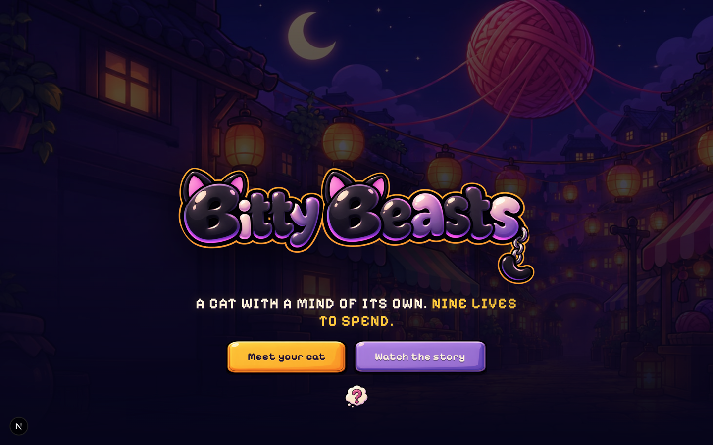

| | |
| --- | --- |
| **Live on** | NEAR testnet — `alley.bittybeasts-6f61b7.testnet` |
| **Contracts** | 3 Rust contracts: NEP-171 + NEP-245 + market, NEP-141, NEP-591 global contract |
| **Verified on testnet** | 20/20 game checks, 15/15 cat-room checks (incl. 4 NEAR AI checks), 26/26 economy checks |
| **Tracks** | Games With Real Economies · NFTs That Do Something · Memecoins With Mechanics · Grand Prize (NEAR AI) |

---

## The one thing to look at

A cat thinks, and you can prove it really was the enclave that said it.

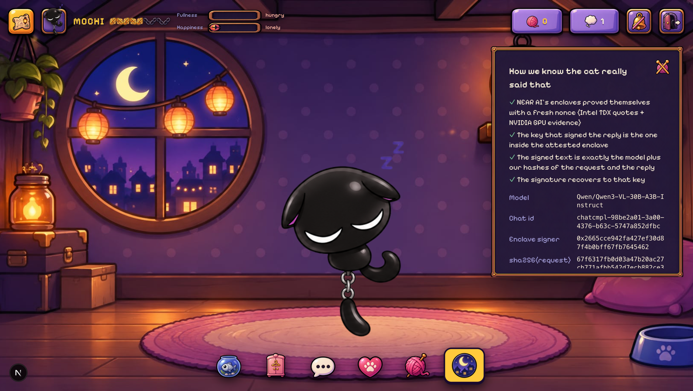

Those four ticks are not decoration. For every reply, the server:

1. Fetches `/v1/attestation/report` with **a fresh 32-byte nonce**, and parses the raw Intel TDX
   quotes for the gateway *and* the model. It checks `report_data == signing address ‖ zero padding
   ‖ our nonce`, that the **TD debug bit is off**, that `MRCONFIGID == 01 ‖ sha256(app_compose) ‖
   0x00 × 15`, and that the NVIDIA GPU evidence carries the same nonce.
2. Runs the completion with `x-no-aliasing: true`, keeping the **exact request and response bytes**.
3. Fetches `/v1/signature/{chat_id}`, rebuilds the signed text `model:sha256(request):sha256(response)`
   **from its own hashes**, recovers the EIP-191 signer, and requires it to equal the attested
   model signer.
4. Only then calls `record_thought`. An unverified reply is dropped and costs the player nothing.

Code: [`lib/server/nearai.ts`](lib/server/nearai.ts) · [`contracts/alley/src/care.rs`](contracts/alley/src/care.rs)

**This runs live.** A thought recorded on testnet, read back from the chain just now:

```json
{
  "said":  "Hey Noddle how are you feeling todauy",
  "reply": "*Purrs and stretches, tail curling like a question mark*\nFull as a bell, but my nine lives are already glowing.\nWant a fish? I've got rooftops to brag about.",
  "model": "Qwen/Qwen3-VL-30B-A3B-Instruct",
  "chat_id": "chatcmpl-f92745af-41a0-4d27-8fae-dfe8ac3525cd",
  "request_hash":  "d03994802dbd9c198cb24522ebe89047a225106d9972cfe6e623d8fd9b261d2f",
  "response_hash": "eeabfe6cd99f1d6d077809c9fab8ba988e9ec068da979aca268217ac33a4b6be",
  "signature": "0xca501c14e67676d5a3b805086ad700c4a86d52e194d82e5d051c997e7616111268004aa2e56c135e0e0dd419b768aed3d31d698d9ab8f483f965ef0152cd9d141c",
  "signing_address": "0x2665cce942fa427ef30d87f4b0bff67fb7645462",
  "signing_algo": "ecdsa"
}
```

Reproduce it:

```sh
near contract call-function as-read-only alley.bittybeasts-6f61b7.testnet thoughts \
  json-args '{"token_id":"demo-cat-3","limit":2}' network-config testnet now
```

The raw bytes stay available at `/api/cat/thought/<chat_id>`, so anyone can recompute both hashes
and check the signature themselves.

---

## Two claims a judge can verify in 30 seconds

Everything else in this README is downstream of these two facts.

**1. A Beast's account has exactly one key, and it can only call `execute`.**

```sh
near account list-keys demo-cat-1.alley.bittybeasts-6f61b7.testnet network-config testnet now
```

```
| # | Public Key              | Permissions                                                   |
| 1 | ed25519:3ZBsSkPHxmm1QW… | only do ["execute"] function calls on                         |
|   |                         | demo-cat-1.alley.bittybeasts-6f61b7.testnet                   |
|   |                         | with an allowance of 0.244 NEAR                               |
```

No full-access key. The NFT owner holds that one function-call key; the alley swaps it on every
sale, deleting the old one **in the same receipt**.

**2. $YARN has no keys at all. Nobody can upgrade it or mint outside the rules.**

```sh
near account list-keys yarn.bittybeasts-6f61b7.testnet network-config testnet now
```

```
+---+------------+-------+-------------+
| # | Public Key | Nonce | Permissions |
+---+------------+-------+-------------+
+---+------------+-------+-------------+
```

The parameters are Rust constants and `params()` reports `admin: null`. `scripts/deploy.ts` deletes
the account's only full-access key after init. This is irreversible — see
[What's not built](#whats-not-built) for the one consequence we have to live with.

---

## Play it in two clicks

No wallet, no seed phrase, no gas prompt, no extension.

| Start your own cat | Or borrow one |
| --- | --- |
| 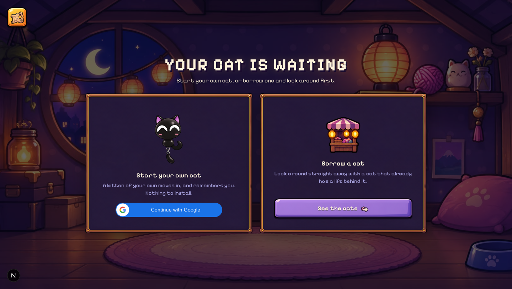 | 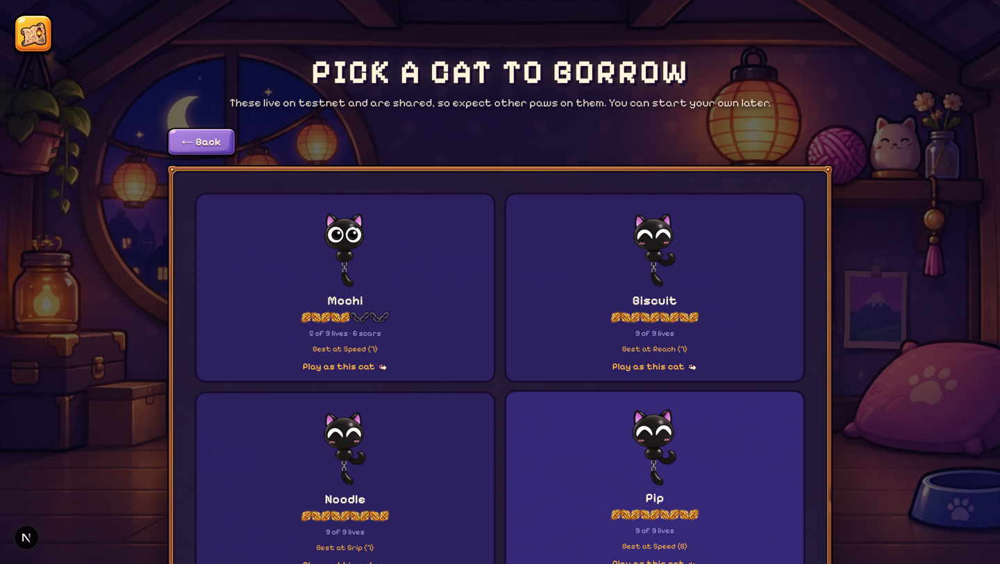 |

Sign in with Google and the server provisions `p<hash>.ROOT` with a key generated in your browser,
then a kitten arrives with welcome gifts from two merchants — each signed by that merchant's own
NEAR key. Or borrow a demo cat: the picker reads every cat's **real on-chain state** (lives, scars,
best stat) so you know who you are choosing.

> Demo keys are published in [`public/demo-accounts.json`](public/demo-accounts.json) **on purpose**
> — testnet NEAR is worth nothing, and judges shouldn't need an account. Server keys stay in
> `.env.local`, never committed.

---

## The loop

### Your room — care that lives on chain

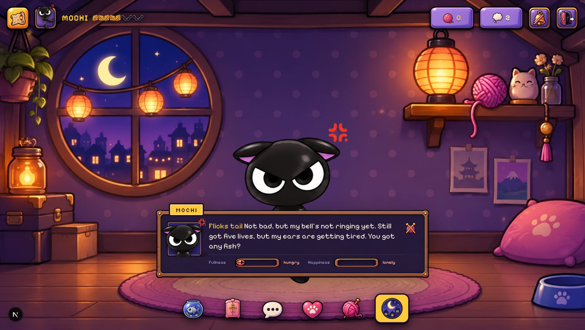

Fullness and happiness decay with real time, on chain. **Feed** burns a fish from the *cat's own*
account. **Wardrobe** wears NEP-245 cosmetics the cat owns. **Personality** writes who your cat is
on chain — and that text goes into the prompt. A starving cat cannot take a daring run.

The cat's prompt is built *only* from contract views: name, lives, marks, best run, persona,
fullness, happiness, outfit, diary, and its last four recorded thoughts
([`lib/server/cat.ts`](lib/server/cat.ts)). Nothing is invented client-side.

### Missions — nine lives, really spent

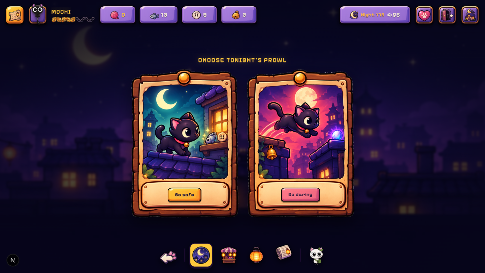

Safe run: loot is minted to the Beast's own account. Daring run that falls: **a link goes dark and
a scar is written into the diary, permanently.** The contract caps the haul by rooftops
([`lib.rs:376`](contracts/alley/src/lib.rs#L376)), so even a compromised referee key cannot print items.

### Lantern Lane — four agents with their own purses

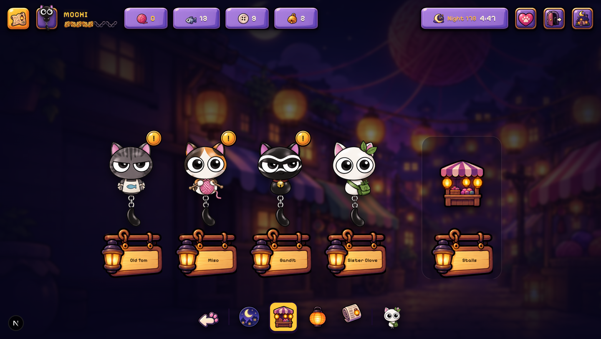

Each merchant is a separate NEAR account with its own YARN purse, till and shelf. It reads the live
alley, prices with [`lib/economy/pricing.ts`](lib/economy/pricing.ts) (16 numbered rules), and
**signs the quote with its own key**. The contract verifies that ed25519 signature before trading
and records a nonce, so a quote cannot be replayed (`market.rs: verify_quote`).

Tap any price to hear the reasoning:

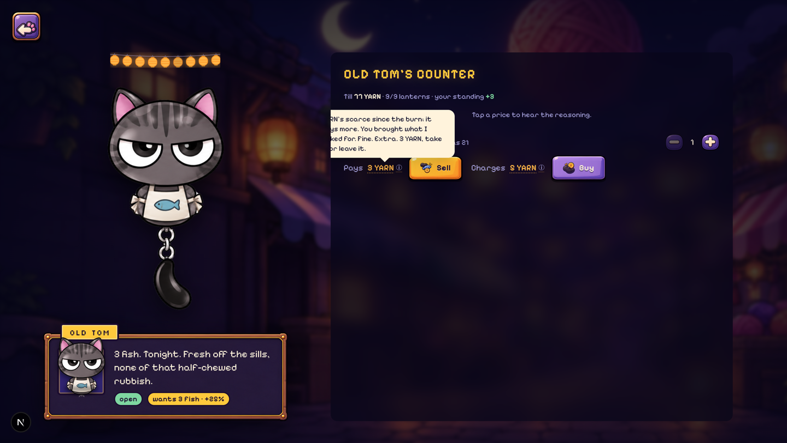

> *"YARN's scarce since the burn; it buys more. You brought what I asked for. Fine. Extra. 3 YARN,
> take it or leave it."*

That sentence is assembled from the rules that actually produced the number — scarcity after a
burn, plus the +25% because Tom had posted a request for fish that night. Merchants go dark when
their till empties, and players relight them.

### $YARN — a memecoin that needs you to show up

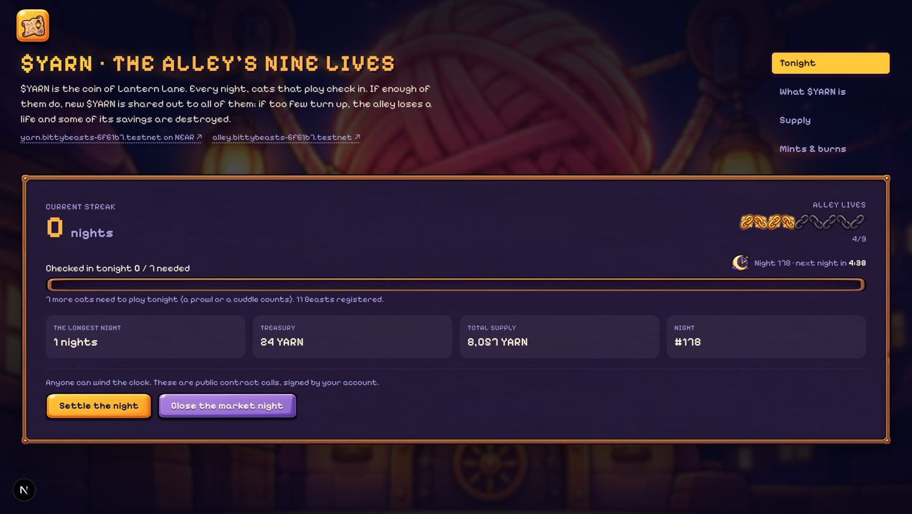

Each night, every woken Beast may **check in once** (a cuddle or a finished prowl). If at least 60%
of registered Beasts check in, every one of them gets 10 YARN. If not, **the alley loses one of its
nine lives and 5% of the treasury burns**. Seven good nights in a row wins a life back. At zero, the
Age ends and a new one begins.

Supply is driven by attendance, not by holding. Every mint and burn is on chain:

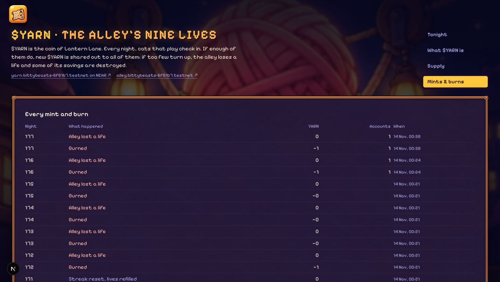

The screenshot above is the honest state of a testnet alley that is mostly empty: misses, burns, and
an Age that keeps turning over. That is the mechanic working, not a bug.

A 60-night model of the same rules ([`scripts/simulate-yarn.ts`](scripts/simulate-yarn.ts), which
mirrors the contract's constants) — clearly labelled in the UI as a model, not chain data:

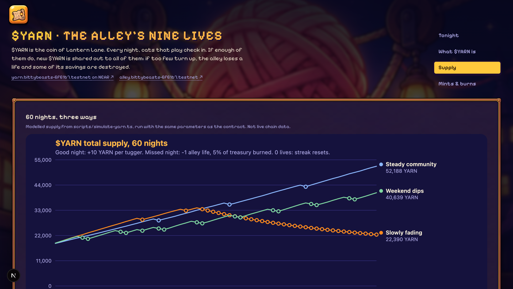

| Scenario | Final supply | Burned | Missed nights | Resets |
| --- | ---: | ---: | ---: | ---: |
| Steady community | 52,188 | 1,952 | 3 | 0 |
| Weekend dips | 40,639 | 7,971 | 17 | 1 |
| Slowly fading | 22,390 | 12,850 | 35 | 3 |

### The Ledger — a story nobody writes

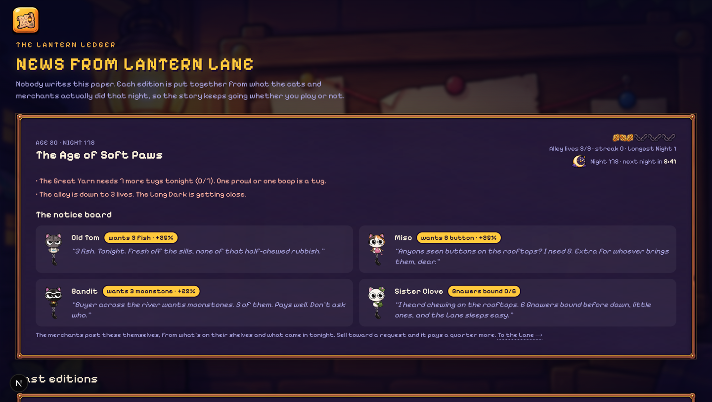

Each edition is assembled from the $YARN log, the alley's night stats and the Beasts' diaries
([`lib/story/ledger.ts`](lib/story/ledger.ts)). The merchants' requests on the notice board are
derived from their own shelves. There is no script and no final mission.

---

## Every move is a transaction

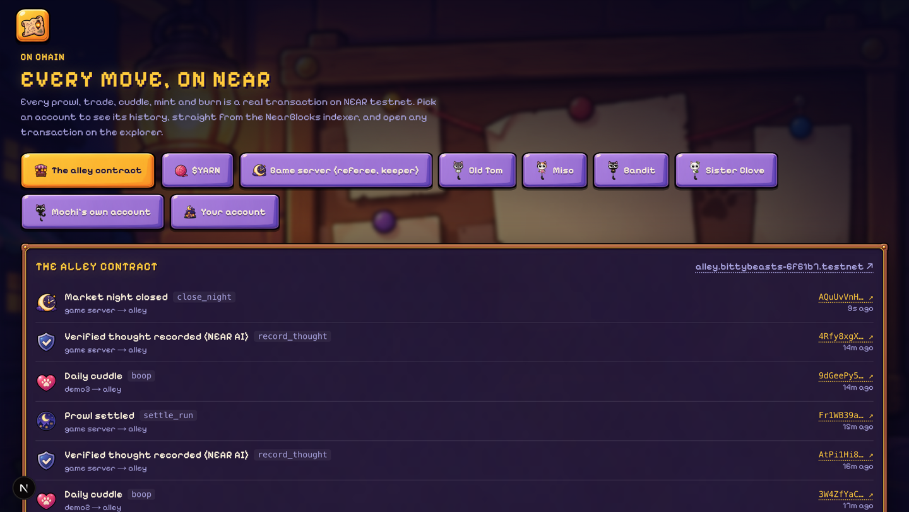

Pick any account — the alley, $YARN, the game server, a merchant, your cat's own account — and read
its real history from the NearBlocks indexer, then open any transaction on the explorer.

And every Beast has a life story where **each diary line links to the transaction that wrote it**:

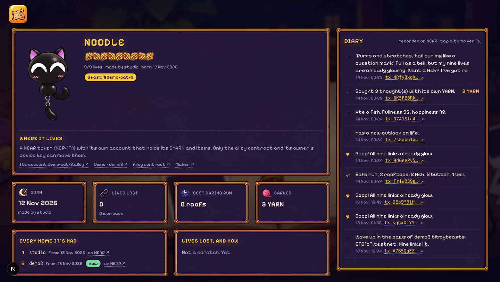

Note the two lines together: *"Bought 3 thought(s) with its own YARN"* and the thought itself. That
is the whole AI-pet economy in two transactions — the cat spent its own money to think.

---

## How the tracks are answered

| Track | What answers it | Verify |
| --- | --- | --- |
| **Grand Prize (NEAR AI)** | TEE attestation with a fresh nonce, raw TDX quote parsing (nonce + signer binding, debug bit, MRCONFIGID, GPU nonce), response-signature recovery matched to the attested signer, then `record_thought` on chain. Unverified replies are dropped. | `lib/server/nearai.ts`; the `thoughts` view above |
| **Games With Real Economies** | 4 merchant agents with their own accounts, purses and **signed** quotes; 16 pricing rules with player-visible reasoning; NEP-245 food and cosmetics; stalls, rent and lights-out shops revived by players; Google sign-in with no seed phrase | `lib/economy/pricing.ts`, `contracts/alley/src/market.rs` |
| **NFTs That Do Something** | Each Beast is NEP-171 **and its own NEAR account** holding its YARN, items, stall earnings, lives, persona and thought credits — and paying for its own AI. Control = one function-call key, swapped by the contract on sale. Royalties (NEP-199), marketplace approvals (NEP-178). | `near list-keys` above; `contracts/beast-wallet` |
| **Memecoins With Mechanics** | NEP-141 with **zero access keys**, compiled-in parameters, `admin: null`. Nightly community check-in mints; missed nights burn. Every AI thought is a YARN sink into the treasury. | `near list-keys yarn.…` above |

---

## Live contracts

| Contract | Account |
| --- | --- |
| Alley (NEP-171 + NEP-245 + market) | [`alley.bittybeasts-6f61b7.testnet`](https://testnet.nearblocks.io/address/alley.bittybeasts-6f61b7.testnet) |
| $YARN (NEP-141, no access keys) | [`yarn.bittybeasts-6f61b7.testnet`](https://testnet.nearblocks.io/address/yarn.bittybeasts-6f61b7.testnet) |
| beast-wallet (NEP-591 global contract) | [`wallet.bittybeasts-6f61b7.testnet`](https://testnet.nearblocks.io/address/wallet.bittybeasts-6f61b7.testnet) |
| A Beast's own account | [`demo-cat-1.alley.bittybeasts-6f61b7.testnet`](https://testnet.nearblocks.io/address/demo-cat-1.alley.bittybeasts-6f61b7.testnet) |
| Merchant agents | `tom.` · `miso.` · `bandit.` · `clove.bittybeasts-6f61b7.testnet` |

```
ROOT (game server: referee + funder)
├── alley.ROOT          Beasts (NEP-171) + items (NEP-245) + Lantern Lane
│   └── <token>.alley.ROOT   one account per Beast, runs the beast-wallet global contract
├── yarn.ROOT           $YARN (NEP-141), keys deleted after init
├── wallet.ROOT         publishes beast-wallet as a NEP-591 global contract
├── studio.ROOT         the artist: registers Beasts, receives royalties
├── tom / miso / bandit / clove.ROOT    merchant agents
└── p<hash>.ROOT        players (Google sign-in)
```

---

## Tests

Run against the **live testnet contracts**, not mocks.

| What | Command | Result |
| --- | --- | --- |
| Live testnet, one Beast's whole life | `tsx scripts/e2e.ts` | **20/20 passed** |
| Cat room on testnet (needs the app running) | `BASE_URL=… tsx scripts/e2e-room.ts` | **15/15 passed**, incl. 4 NEAR AI checks |
| Economy rules and nightly requests | `tsx scripts/check-economy.ts` | **26/26 passed** |
| Contract unit tests | `cd contracts && cargo test` | 53 tests in source (alley 34, beast-wallet 10, yarn 9) |

The resale security model is covered by the e2e run, each line a real transaction:

```
ok  wander: seller cannot move anything out (wallet frozen)  (rejected)
ok  adopt: old key deleted, only the buyer's key remains  (1 key(s))
ok  adopt: lives, marks and YARN moved with the Beast
ok  adopt: maker received the 10% royalty  (10000000000000000000000 yocto)
ok  adopt: the seller's old key is rejected
ok  a used quote cannot be replayed
```

And the NEAR AI path, end to end on a fresh player account:

```
ok  thoughts: 3 YARN from the kitten's purse buys 3 thoughts
ok  talk: NEAR AI replied and every check passed
    {"attestation":true,"textMatches":true,"signerRecovered":true,"signerAttested":true}
ok  talk: the thought is recorded on chain and one credit spent
ok  talk: on-chain record carries NEAR AI's chat id and signature
```

### Threat model: every way a seller could keep the money

| Attempt | What stops it | Proof |
| --- | --- | --- |
| Drain YARN or items before the sale | `wander` freezes the wallet; `execute` panics | e2e: "seller cannot move anything out" |
| Keep an old access key | `adopt` deletes it in the same receipt | e2e: "only the buyer's key remains" |
| Sell mid-payout | Payouts target the **Beast's account**, so late arrivals belong to the buyer | e2e: "YARN moved with the Beast" |
| Burn lives on reckless runs after agreeing a price | A wandering Beast cannot prowl | unit test `wandering_beast_cannot_prowl` |
| Re-adopt their own Beast | `adopt` rejects the seller | unit test `seller_cannot_readopt` |
| Replay a merchant's price | Each quote carries a nonce the contract records | e2e: "a used quote cannot be replayed" |
| Use the old key after selling | The wallet only obeys the current controller; only the alley can swap it | `an_old_key_is_refused_after_a_handover` |
| Re-use a photo of the QR card | Only a live wander can be adopted, once. **Limit:** whoever saw the card knows the secret; the physical product needs NFC | — |
| Hand over the keychain without starting a wander | Not fixable on chain. Buyers should pay only once the Beast is wandering | — |

---

## Run it

Requirements: Node 24, pnpm, Rust stable with `wasm32-unknown-unknown`, `cargo-near`.

```sh
pnpm install
pnpm approve-builds                  # allow esbuild (used by tsx)

# contracts
cd contracts && cargo test && for c in beast-wallet yarn alley; do
  (cd $c && cargo near build non-reproducible-wasm --no-abi); done; cd ..

# deploy to testnet: creates accounts through the faucet (free), deploys the contracts
# (and deletes $YARN's key), registers Beasts, creates the demo players. Keys -> .env.local
./node_modules/.bin/tsx scripts/deploy.ts

# the cat's brain: a NEAR AI Cloud API key (cloud.near.ai -> API Keys)
echo "NEAR_AI_API_KEY=..." >> .env.local    # optional: NEAR_AI_MODEL

# Google sign-in
echo "NEXT_PUBLIC_GOOGLE_CLIENT_ID=..." >> .env.local

pnpm dev                             # http://localhost:3000

pnpm story:render                    # the story film as out/story.mp4
```

Optional: keep the world turning (closes nights, settles $YARN, merchants restock):

```sh
set -a; source .env.local; set +a; ./node_modules/.bin/tsx scripts/keeper.ts
```

### Walk the whole loop yourself

1. `tsx scripts/e2e.ts` — 20 checks against the deployed contracts.
2. On `/`, **Meet your cat** → **Borrow a cat** → pick one. You are playing a real testnet account.
3. **Feed**, **Wardrobe**, **Personality**, **Cuddle** in `/room`. Each is a transaction.
4. **Talk**, then tap **verified thought** to see the attestation, signer, hashes and raw bytes.
5. `/alley` → **prowl**. Take the daring run and watch a life go dark.
6. Sell to Old Tom in Lantern Lane; hover the price to read his reasoning.
7. `/yarn` — your prowl moved tonight's bar. Press **Settle the night** after it ends.
8. `/ledger`, then `/activity` — read it all back from the chain.
9. `/beast/<token>` — every diary line links to the transaction that wrote it.

---

## What's not built

Written plainly, because a README is not evidence and the judges read code.

- **`nft_item_info` is written but not deployed.** Beasts are designed to answer as
  `sharded-item-1.0.0` — the Top Level Accounts draft NEP
  ([houseofstake/tla-contracts](https://github.com/houseofstake/tla-contracts),
  [`docs/sharded-nft-items.md`](docs/sharded-nft-items.md)) for collections whose tokens are real
  accounts. The contract method and the consumer-side `verifyBeastItem()` are both written and
  unit-tested, but the live Beast accounts still run the previous wallet build, so
  `nft_item_info` does **not** resolve on chain yet. Republishing the global contract makes it live.
- **NEAR AI verification is not the full chain of trust.** We check nonce and signer binding, the
  debug bit, the measured config and the GPU nonce inside the raw quotes, and the reply signature
  against the attested signer. We do **not** run Intel DCAP signature-chain verification
  (`dcap-qvl`) or NVIDIA NRAS. The quotes are kept with each thought so anyone can.
- **Inference is paid in YARN, not NEAR.** NEAR AI bills an API key bought off chain; the cat's YARN
  pays the game and lands in the treasury. The **Agent API is not used** — it is a mainnet-only
  beta for agents moving funds through Intents under an owner-signed policy, which is a different
  thing from an access key that moves with an NFT.
- **NEAR Intents and Chain Signatures are not used.** No cross-chain path exists in this project.
- **Raw thought bytes live on the server's disk** (`.data/thoughts`), not on chain. The on-chain
  record keeps the hashes and NEAR AI's signature.
- **The alley contract can still be upgraded** (its key is kept for the hackathon). Because only the
  alley may report check-ins to $YARN, whoever holds that key could change who mints.
  `scripts/lock-alley.ts --yes-lock-forever` deletes it after verifying the deployed code matches
  the build; it has **not** been run. $YARN itself has no keys.
- **The $YARN storage-griefing fix ships in source, not on chain.** The deployed token pays storage
  for any new receiver, so someone could drain its NEAR with dust transfers. The source now charges
  strangers (`transfers_do_not_pay_storage_for_strangers`). Because $YARN has no keys, **the live
  token cannot be upgraded** — the fix needs a fresh deployment.
- **Trusted server roles.** The referee settles prowls (the contract caps the haul and refuses
  daring runs at zero lives, but the run is reported by the server). The studio registers Beasts.
  The keeper only calls public, idempotent methods. Merchants price by fixed rules, not by a model.
- **Sybil limits.** Only a woken Beast can check in, once per night. Someone with five keychains
  gets five check-ins (intended). Anyone who has seen a QR card can claim an unwoken Beast, so the
  physical product needs NFC.
- **Rate limits are in memory**, per server instance. A multi-instance deployment needs a shared store.
- **The server holds a recovery key on every player account.** Each browser generates its own key,
  but a browser-only key means closing an incognito window strands the account forever (NEAR does
  not let a parent account add keys to an existing subaccount). So accounts are created with the
  browser's key *and* the server's, and signing in from a new device uses the latter to add the
  former — up to 5 devices. The honest consequence: **the game server can act as any player.**
  Beast actions are still signed by the Beast's own function-call key. A production build would
  replace this with device-to-device linking or a passkey.
- **Demo cats are shared.** Two people on the same cat can collide on nonces; pick another.
- **Testnet only.** Mainnet is ~16 NEAR of mostly refundable storage deposits.
- **Not built at all:** stall counteroffers, investor payback, lend-a-life, the council vote
  (a placeholder in the Back Alley), Bandit's stolen-goods tagging, thieves tracked on chain,
  and `$YARN` on meme.cooking.
- **Fast-forward (`/fast-forward`) is a simulation**, labelled as one in the UI. It runs the same
  `pricing.ts` and `events.ts` as the live market.

---

## Repository map

```
contracts/      alley (NEP-171 + NEP-245 + market), yarn (NEP-141), beast-wallet (global contract)
app/            Next.js 16 pages and route handlers (api: auth, prowl referee, merchant agents)
lib/chain/      browser chain layer (keys, views, signed actions, Borsh for the wallet)
lib/economy/    pricing.ts, requests.ts, events.ts, yarn.ts, sim.ts, live.ts
lib/server/     server keys, Google token verification, merchant quote signing, nearai.ts, keeper.ts
lib/story/      world.ts, ledger.ts (the Lantern Ledger and the Ages)
remotion/       the story film: script.ts, world.tsx, scenes.tsx
scripts/        deploy.ts, e2e.ts, e2e-room.ts, keeper.ts, good-night.ts, lock-alley.ts,
                simulate-yarn.ts, check-economy.ts, slice-sheets.mjs, slice-ui.mjs
docs/           STORY.md, ARCHITECTURE.md, sharded-nft-items.md, yarn-sim.{md,svg,csv}, shots/
```

Art — cats, merchants, scenes and the UI kit — is the artist's own work (`public/sheets`,
`public/bg`, cut into `public/art` by `scripts/slice-sheets.mjs` and `scripts/slice-ui.mjs`).

More: [docs/STORY.md](docs/STORY.md) · [docs/ARCHITECTURE.md](docs/ARCHITECTURE.md) ·
[docs/sharded-nft-items.md](docs/sharded-nft-items.md) · [docs/yarn-sim.md](docs/yarn-sim.md)
