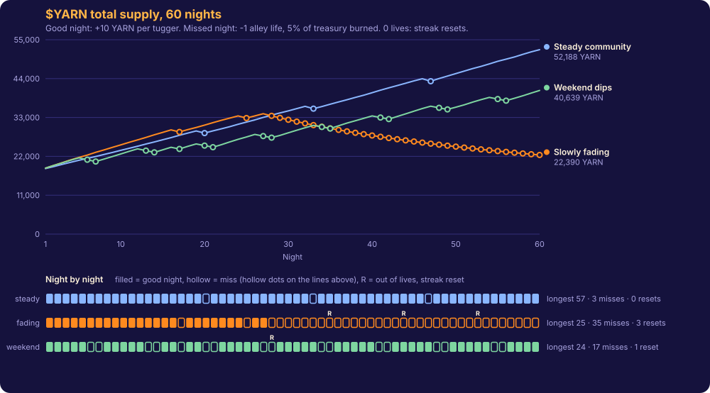

# $YARN 60-night supply simulation

Generated by `scripts/simulate-yarn.ts` (seed 2026) using the contract rules mirrored in `lib/economy/yarn.ts`:
target 60% of registered Beasts, 10 YARN per tugger on a good night,
5% of the treasury burned on a miss, 9 lives, +1 life per 7 consecutive good nights.
Genesis supply 18,000 YARN (10,000 treasury + four 2,000 merchant purses, as in the contract); the treasury fills from stall rent (12 x 5 YARN) and the 2% market fee.

| Scenario | Final supply | Minted | Burned | Missed nights | Resets | Longest Night | Festivals | Lives / streak at night 60 |
| --- | ---: | ---: | ---: | ---: | ---: | ---: | ---: | --- |
| Steady community | 52,188 | 36,140 | 1,952 | 3 | 0 | 57 | 0 | 9 / 57 |
| Slowly fading | 22,390 | 17,240 | 12,850 | 35 | 3 | 25 | 0 | 2 / 0 |
| Weekend dips | 40,639 | 30,610 | 7,971 | 17 | 1 | 24 | 1 | 1 / 24 |

**Reading.** A steady community mints on almost every night, so supply climbs in a straight line and the alley keeps its lives (3 misses, 0 resets). A slowly fading community stops minting once turnout drops under 60%: supply flattens, the treasury is burned 5% at a time (12,850 YARN in total) and the alley runs out of lives 3 times, so its streak resets. Weekend dips cost two lives a week and rarely allow seven good nights in a row to win one back, so even an active-on-weekdays alley eventually resets (1 reset): supply is driven by showing up, not by holding.

Festivals only appear after a reset: the first streak has no Longest Night to beat.
